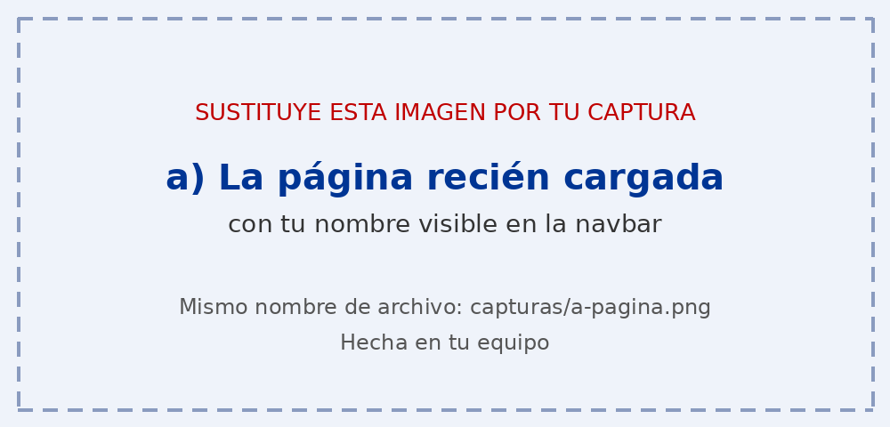
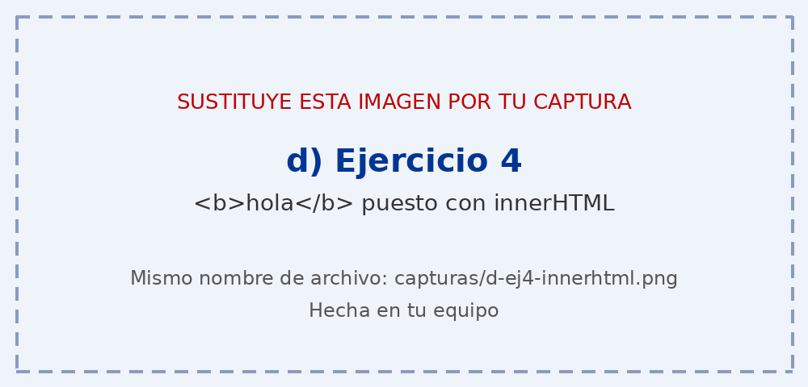
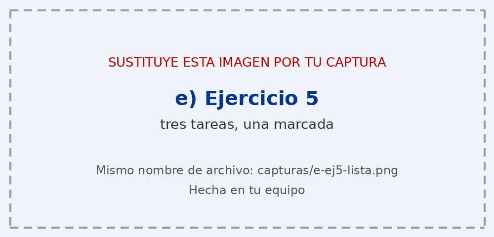
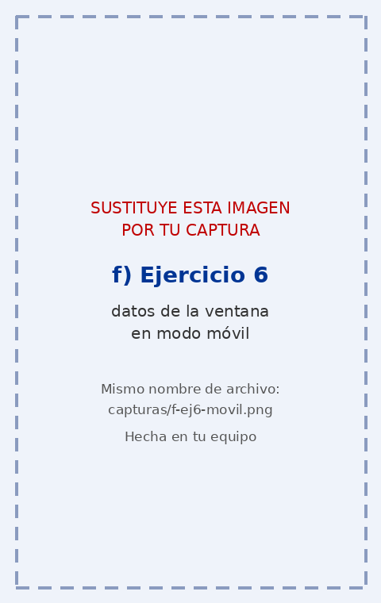

# Tarea 5 · Manipular el DOM

**Autor:** [Tu nombre y apellidos] · Desarrollo Web en Entorno Cliente (DWEC) · 2.º DAW · Curso 2026-27

> **Plantilla de la tarea 5.** Cómo usarla:
>
> 1. Copia esta carpeta en tu repositorio de DWEC y cámbiale el nombre a `tema05`.
> 2. `index.html` ya está maquetado: es la página que vas a manipular. No cambies los `id` ni las clases que usa el JavaScript.
> 3. `js/app.js` trae una función por botón con `TODO`, y modelos en los ejercicios 1, 3 y 6.
> 4. Sustituye las imágenes de `capturas/` por las tuyas, **con el mismo nombre**.
> 5. Todo lo que va entre [corchetes] es un hueco: cámbialo por lo tuyo. Al terminar, borra este aviso.

[Una o dos líneas: qué hay en esta carpeta y cómo se ve. Por ejemplo: abrir la carpeta en VS Code, pulsar **Go Live** y probar los botones con la consola abierta (F12).]

## Capturas

### a) La página recién cargada

[Qué se ve: tu nombre y los tres párrafos de partida.]

### b) Ejercicios 1 y 2

[Qué ha cambiado en cada párrafo y qué selector has usado para cada uno.]

### c) Ejercicio 3: resaltado al pasar el ratón

[Qué párrafo está resaltado y qué pasa con los párrafos que añades después.]

### d) Ejercicio 4: `<b>hola</b>` con innerHTML

[Qué salía con «Cambiar texto» y qué sale con innerHTML.]

### e) Ejercicio 5: la lista de tareas

[Tres tareas, una marcada, antes de pulsar «Borrar completadas».]

### f) Ejercicio 6: los datos de la ventana en el móvil

[Qué punto de corte sale en el móvil y cuál en tu ordenador.]

## Reflexión

[De 5 a 8 líneas: ¿qué diferencia hay entre textContent e innerHTML y por qué no se debe meter en innerHTML lo que escribe el usuario? Pon como ejemplo lo que pasó con `<b>hola</b>`.]

## Fuentes

- [Título de la página](https://enlace-a-la-fuente)

## Uso de IA

[Si has usado IA: qué herramienta, para qué y qué hiciste después con su respuesta. Si no la has usado, borra este apartado.]
