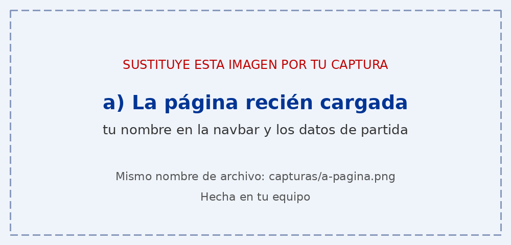
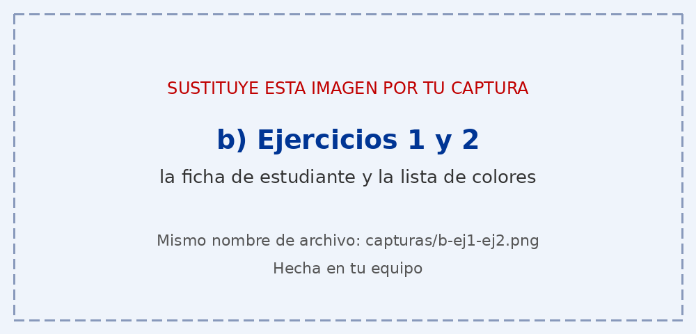
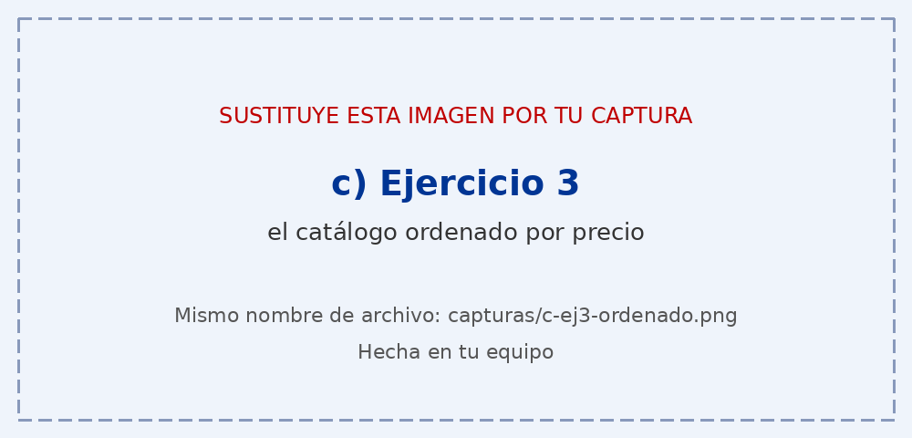
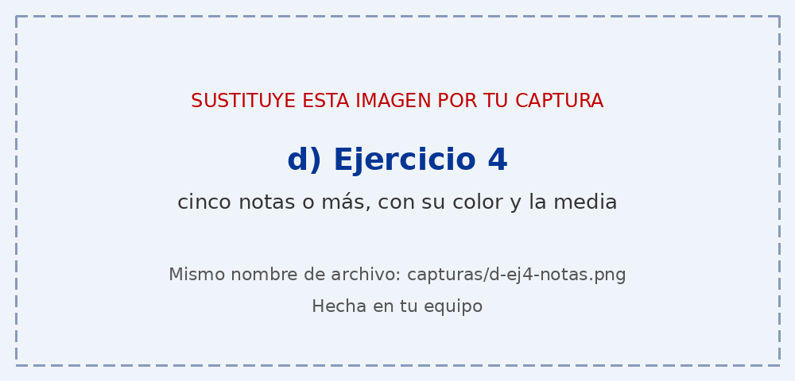
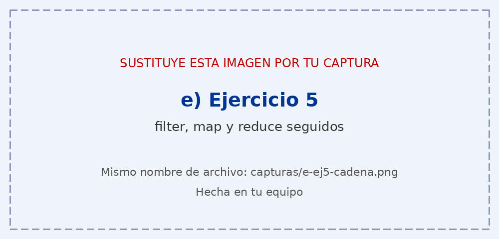
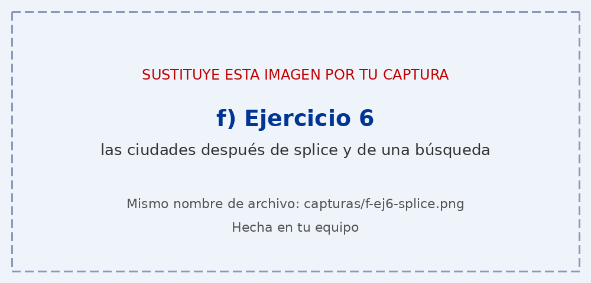

# Tarea 6 · Objetos y arrays

**Autor:** [Tu nombre y apellidos] · Desarrollo Web en Entorno Cliente (DWEC) · 2.º DAW · Curso 2026-27

> **Plantilla de la tarea 6.** Cómo usarla:
>
> 1. Copia esta carpeta en tu repositorio de DWEC y cámbiale el nombre a `tema06`.
> 2. `index.html` ya está maquetado: seis tarjetas, una por ejercicio. No cambies los `id` ni el `onclick` de los botones.
> 3. `js/app.js` trae una función por botón con `TODO`. Ya están hechas `comoTexto()`, `pintarProductos()` y casi todo el ejercicio 2: úsalas de modelo.
> 4. Todas las funciones con `function`: en esta tarea, sin funciones flecha.
> 5. Sustituye las imágenes de `capturas/` por las tuyas, **con el mismo nombre**.
> 6. Todo lo que va entre [corchetes] es un hueco: cámbialo por lo tuyo. Al terminar, borra este aviso.

[Una o dos líneas: qué hay en esta carpeta y cómo se ve. Por ejemplo: abrir la carpeta en VS Code, pulsar **Go Live** y probar los botones con la consola abierta (F12).]

## Capturas

### a) La página recién cargada

[Qué se ve nada más cargar: tu nombre, los colores, la tabla de productos y las ciudades.]

### b) Ejercicios 1 y 2: la ficha y los colores

[La ficha después de cumplir años y la lista de colores después de añadir y quitar alguno. Qué método has usado para cada cosa.]

### c) Ejercicio 3: el catálogo ordenado por precio

[Cómo es tu función de comparación y por qué ordenas una copia.]

### d) Ejercicio 4: las notas y la media

[Cinco notas como mínimo, aprobadas y suspensas, con su media.]

### e) Ejercicio 5: los tres métodos seguidos

[Qué hace cada paso y qué número sale al final.]

### f) Ejercicio 6: después de splice y de buscar una ciudad

[Qué ciudades ha quitado splice, en qué posición ha quedado la que has buscado y por qué.]

## Reflexión

[De 5 a 8 líneas: ¿qué métodos de los que has usado cambian el array original y cuáles devuelven uno nuevo? Pon como ejemplo lo que pasa en el ejercicio 6 con slice y con splice, y explica por qué en el ejercicio 3 ordenas una copia.]

## Fuentes

- [Título de la página](https://enlace-a-la-fuente)

## Uso de IA

[Si has usado IA: qué herramienta, para qué y qué hiciste después con su respuesta. Si no la has usado, borra este apartado.]
